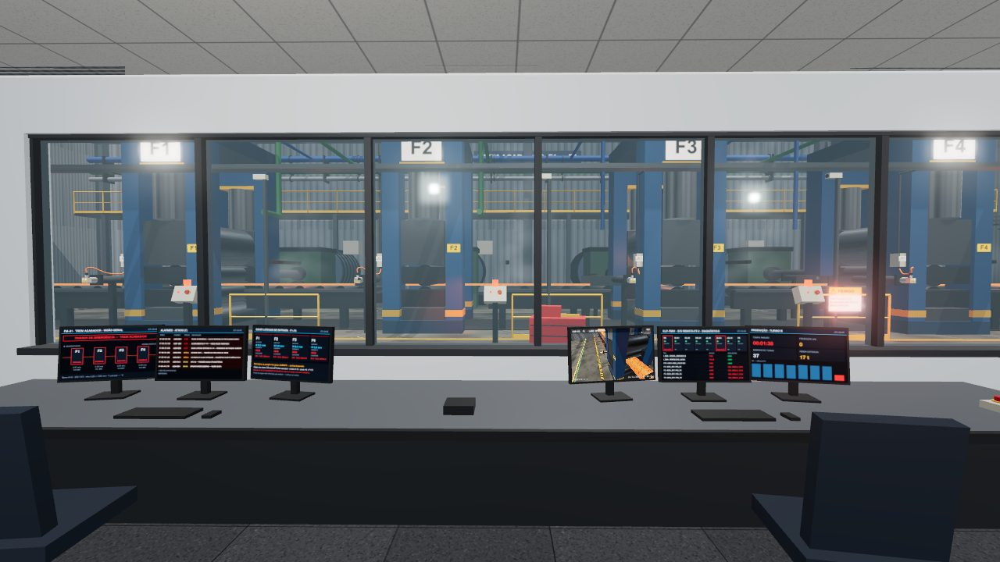
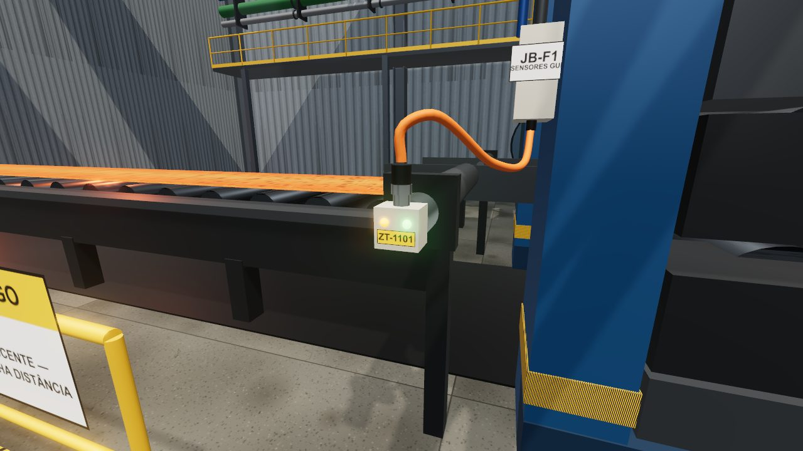
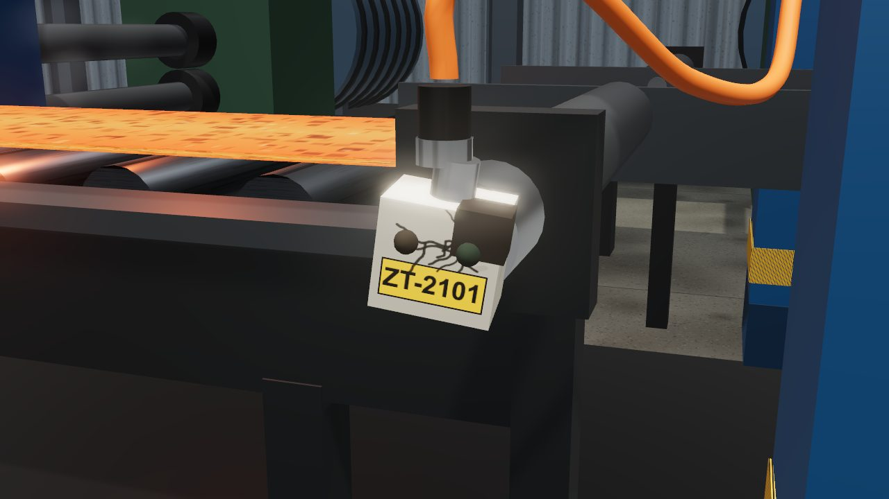

# Simulação 3D: Laminador de Tiras a Quente (FM-01)

Ambiente 3D em primeira pessoa usado na demo do copiloto industrial (UNMUTE by Agora).

**Cenário:** o trem acabador sofre uma **parada de emergência**. Como acontece na planta real, os sistemas
**não dizem onde está o problema**: disparam vários alarmes quase ao mesmo tempo e um diagnóstico
coletivo de módulo de E/S deixa as quatro guias laterais (F1 a F4) sem sinal. A causa raiz só aparece
**olhando o equipamento**: um transdutor de posição **quebrado por impacto**. O técnico percorre a linha.
O agente conversacional da Agora vê a **câmera do capacete** e decide, conversando com o técnico, onde
está o defeito. O técnico então faz a intervenção e a linha volta a produzir.

A simulação também expõe uma **API HTTP local**. Ela separa o que a planta mostra (o **estado
observável**, que o agente pode receber) do **gabarito** (para validar a resposta do agente, sem entregá-lo a ele).

> Escopo: só o mundo virtual e os dados dele. Não há agente, Agora, IA nem autenticação aqui.
> O diagnóstico é papel do agente.



> **Prints de referência para o time do agente:** [docs/referencia-agente/](docs/referencia-agente/README.md)
> (sem HUD, iguais ao `/api/snapshot`, com a descrição de cada pista visual).

---

## 1. Como executar

Pré-requisito: Node.js 18 ou superior (testado com Node 26).

```bash
git clone https://github.com/victorsampereira/unmute-laminador-sim.git
cd unmute-laminador-sim
npm install        # só na primeira vez
npm start          # sobe a simulação + API na porta 5173
```

Abra **http://localhost:5173** no Chrome, Edge ou Firefox e clique em **"Clique para entrar"** ou
**"Modo vida real"**.

- Precisa ter **uma aba** com a simulação aberta para a API funcionar, porque é o navegador que roda a simulação.
- Para acesso de outra máquina na rede: `npx vite --port 5173 --host`.
- Computador fraco: `http://localhost:5173/?quality=low` (sem sombras e sem bloom).

### Parâmetros de URL

| Parâmetro | Efeito |
|---|---|
| `?immersive` | Abre direto no **modo vida real** (nenhum texto na tela) |
| `?quality=low` | Modo leve (sem sombras/bloom, resolução 1x) |
| `?hints=0` | Esconde as dicas de objetivo |
| `?machine=F3` | Já abre com o defeito em outra cadeira |
| `?autostart` | Pula a tela inicial (testes automatizados, quiosque) |

---

## 2. Controles

| Tecla | Ação |
|---|---|
| `W A S D` | Andar (`Shift` corre) |
| Mouse | Olhar (ou setas do teclado; sem pointer lock, arraste com o botão esquerdo) |
| Botão direito (segurar) | Zoom, para ler os monitores e olhar de perto |
| `E` | Reconhecer os alarmes (olhando para o monitor de alarmes) |
| `E` (segurar ~1,3 s) | **Substituir o transdutor** para o qual você está olhando. Funciona igual em qualquer cadeira e só resolve no componente defeituoso |
| `V` | **Modo vida real**: liga/desliga a imersão total, sem nenhum texto na tela |
| `R` `R` | Reiniciar a demo (pressione duas vezes em até 1,5 s) |
| `H` | Mostrar/ocultar dicas de objetivo |
| `M` | Ligar/desligar o som |
| `Esc` | Pausar / soltar o mouse |

### Modo vida real

Na tela inicial, o botão **"Modo vida real"** (ou a tecla `V` a qualquer momento) esconde todo o HUD.
Sobra só o mundo 3D. O único feedback é a mira, que fica âmbar quando há algo para interagir, e o anel
de progresso ao segurar `E`. Os monitores da sala de controle continuam funcionando, porque fazem
parte do mundo.

## 3. Roteiro da demo (cerca de 2 minutos)

1. **Sala de controle.** Tudo indica parada de emergência e nada aponta o culpado:
   - **Visão geral:** as quatro cadeiras aparecem iguais, todas "PARADA".
   - **Alarmes:** 7 alarmes disparados no mesmo segundo (laço de segurança, acionamentos, permissivo das
     guias F1–F4, looper, diagnóstico da E/S remota, HPU, sprays).
   - **Guias laterais:** as quatro guias com feedback `####` e qualidade BAD, por diagnóstico coletivo do
     módulo AI-04. O próprio painel diz que o canal de origem não foi informado e que é preciso verificar em campo.
   - **CLP:** módulo AI-04 com o LED de erro aceso.
   - **Câmera de vigilância:** passa por F1 a F4, 6 s em cada.
   - **Ação:** pressione `E` no monitor de alarmes para reconhecê-los.
2. **Galpão.** Todas as cadeiras estão com o andon vermelho e o giroflex girando. Nenhuma se destaca.
3. **Investigação guiada pelo agente.** O alarme de grupo aponta para as guias laterais de entrada. O agente
   pede para olhar os transdutores de posição, um em cada cadeira, no lado operador, na ponta do cilindro
   da guia, a cerca de 1,5 m de altura.
4. **Evidência.** Nos transdutores sem defeito, os LEDs verde e âmbar ficam acesos e a carcaça está inteira.
   No defeituoso (padrão: **F2 / ZT-2101**):
   - LEDs **apagados**;
   - carcaça **trincada**, com uma **lasca faltando** no canto e a eletrônica exposta;
   - cabeça levemente **torta**;
   - **fragmentos** no chão, logo abaixo.

   O cabo e o conector estão intactos. As placas "F2", "JB-F2" e "ZT-2101" ficam legíveis na foto.
5. **Palpite errado é possível.** Substituir um transdutor bom (segurar `E`) é registrado, mas nada muda e a linha continua parada.
6. **Correção.** Segurar `E` no transdutor quebrado faz a troca: aparece um transdutor novo, com os LEDs acesos.
   Os alarmes normalizam, a linha passa por cerca de 5 s de **partida** e entra **em produção**: rolos
   girando, tira andando, vapor, andons verdes.
7. `R` `R` (ou `POST /api/reset`) volta tudo ao início.

| Transdutor OK (F1) | Transdutor quebrado (F2), foto do capacete |
|---|---|
|  |  |

---

## 4. API para o restante da equipe

A API usa a mesma porta da página (`http://localhost:5173`), aceita CORS de qualquer origem e responde em JSON.

| Método e rota | Descrição |
|---|---|
| `GET /api` | Índice com os endpoints e `simulationConnected` |
| `GET /api/state` | **Estado observável**: o que a planta mostra (linha, alarmes, tags de CLP, posição do técnico, intervenções). **Não revela o componente defeituoso.** Pode ser entregue ao agente. |
| `GET /api/snapshot` | **Foto da câmera do capacete**: JPEG 1280 px do ponto de vista do técnico, sem nenhum HUD |
| `GET /api/events` | **Server-Sent Events**: `event: state` (estado observável) e `event: sim` (eventos de domínio) |
| `GET /api/truth` | **Gabarito**: máquina, componente, tipo de falha, evidências visuais esperadas e se já foi corrigido. Use para validar o agente, não para alimentá-lo |
| `POST /api/reset` | Reinicia o cenário e leva o técnico de volta à sala de controle |
| `POST /api/start` | Reinicia o cenário atual **sem** mover o técnico |
| `POST /api/scenario` | Troca o cenário: `{"machineId":"F1..F4","faultType":"..."}` |
| `POST /api/command` | Comando genérico `{"type": "...", ...}` (lista abaixo) |

`?truth=1` em `/api/state`, em `/api/events` ou nos `POST` inclui o gabarito (`groundTruth`) na resposta.
Comandos de `POST` respondem `{ ok, result, state }`. Quando não há navegador com a simulação aberta, respondem `503`.

### Fluxo sugerido para o agente

```
foto  = GET /api/snapshot          → enviar ao modelo de visão ("o que há de errado neste equipamento?")
ctx   = GET /api/state             → alarmes, tags do CLP, onde o técnico está (player.nearMachine, lookingAt)
...conversa com o técnico...       → o técnico vai até a cadeira, segura E no transdutor
eventos (SSE)                      → component_intervention {changed}, component_fixed, machine_state_changed
GET /api/truth                     → (só para a equipe) conferir se o agente acertou
```

### Exemplos

```bash
# estado observável (o que o agente pode ver)
curl -s localhost:5173/api/state | jq '{line: .line.state, alarms: [.alarms[] | .code + " " + .message], perto: .player.nearMachine, olhando: .player.lookingAt}'

# foto da câmera do capacete
curl -s localhost:5173/api/snapshot -o capacete.jpg

# gabarito (validação)
curl -s localhost:5173/api/truth | jq

# eventos em tempo real
curl -N localhost:5173/api/events

# reiniciar / colocar o transdutor quebrado em outra cadeira
curl -s -X POST localhost:5173/api/reset
curl -s -X POST localhost:5173/api/scenario -H 'Content-Type: application/json' -d '{"machineId":"F3"}'

# modo vida real pela API
curl -s -X POST localhost:5173/api/command -H 'Content-Type: application/json' -d '{"type":"set_immersive","enabled":true}'
```

```js
const es = new EventSource('http://localhost:5173/api/events');
es.addEventListener('sim', (e) => {
  const ev = JSON.parse(e.data); // {type, at, ...}
  if (ev.type === 'player_near_machine') console.log('Técnico chegou à cadeira', ev.machineId);
  if (ev.type === 'component_intervention') console.log(ev.componentId, ev.changed ? 'resolveu' : 'não mudou nada');
  if (ev.type === 'component_fixed') console.log('Linha liberada!');
});
```

### Comandos (`POST /api/command`)

| `type` | Campos | Efeito |
|---|---|---|
| `reset` | `teleport?: bool` (padrão `true`) | Reinicia o cenário |
| `start` | `teleport?: bool` (padrão `false`) | Reinicia sem mover o técnico |
| `set_scenario` | `machineId`, `faultType`, `teleport?` | Troca máquina/falha |
| `ack_alarm` | | Reconhece todos os alarmes |
| `intervene` | `machineId` (`F1`..`F4`) | Intervém no transdutor daquela cadeira (igual a segurar E). Resolve só se for o defeituoso |
| `fix` | | Atalho de ensaio: corrige o defeito real, onde estiver |
| `teleport` | `to`: `control_room` \| `door` \| `hall` \| `F1`..`F4` \| `component` (o defeituoso) \| `{x,z,yaw}` | Move o técnico para frente do transdutor |
| `set_immersive` | `enabled: bool` | Modo vida real |
| `set_hints` | `enabled: bool` | Dicas de objetivo |
| `snapshot` | `width?` | Retorna `image` (data URL JPEG) |

### Cenário

Há um único defeito, `faultType: "sensor_broken"` (transdutor quebrado por impacto). Com `"none"`, a linha roda sem falha.
Dá para escolher **em qual cadeira** ele está: `machineId` `F1`, `F2` (padrão), `F3` ou `F4`. Os componentes são
`ZT-1101`, `ZT-2101`, `ZT-3101` e `ZT-4101`. Os alarmes e as telas são **os mesmos** para qualquer cadeira, o que
mantém a ambiguidade.

### Dentro da página (`window.sim`)

`sim.getState()` (inclui `groundTruth`), `sim.on(fn)`, `sim.reset()`, `sim.setScenario('F3','sensor_broken')`,
`sim.ackAlarm()`, `sim.intervene('F2')`, `sim.fix()`, `sim.teleport('F2')`, `sim.setImmersive(true)` e `await sim.snapshot()`.

---

## 5. Modelo de dados

### `GET /api/state` (observável)

```jsonc
{
  "version": 42, "updatedAt": "...", "connected": true,
  "ui": { "hints": true, "immersive": false },
  "scenario": { "status": "active", "startedAt": "..." },          // active | resolved | no_fault
  "line": { "id": "FM-01", "state": "TRIPPED", "stateSince": "...", "downtimeSeconds": 131 },
                                                                    // TRIPPED | RECOVERING | RUNNING
  "machines": [ { "id": "F1", "state": "EMERGENCY_STOP", "componentIds": ["ZT-1101"] }, ... ],
                                                                    // EMERGENCY_STOP | STARTING | RUNNING (iguais para todas)
  "alarm":  { "code": "ALM-0001", ... },                            // primeiro alarme da lista
  "alarms": [
    { "code": "ALM-0001", "severity": "HIGH",   "message": "PARADA DE EMERGÊNCIA — LAÇO DE SEGURANÇA DO TREM ACABADOR ABERTO", "raisedAt": "...", "active": true, "acknowledged": false },
    { "code": "ALM-1203", "severity": "HIGH",   "message": "ACIONAMENTOS F1–F4 — HABILITAÇÃO REMOVIDA", ... },
    { "code": "ALM-0950", "severity": "HIGH",   "message": "GUIAS LATERAIS ENTRADA F1–F4 — PERMISSIVO DE POSIÇÃO AUSENTE", ... },
    { "code": "ALM-0733", "severity": "MEDIUM", "message": "LOOPER F2/F3 — TENSÃO DA TIRA FORA DA FAIXA", ... },
    { "code": "ALM-2210", "severity": "MEDIUM", "message": "E/S REMOTA ET-2 (LADO OPERADOR) — DIAGNÓSTICO COLETIVO MÓDULO AI-04", ... },
    { "code": "ALM-0412", ... }, { "code": "ALM-0961", ... }
  ],
  "activeAlarmCount": 7,
  "plc": {
    "LINHA.PARADA_EMERGENCIA": { "value": true },
    "LINHA.PERMISSIVO_GUIAS":  { "value": false },
    "ET2.AI04.DIAG_COLETIVO":  { "value": true },
    "F1.GUIA_ENT.POS_FB": { "value": null, "unit": "mm", "quality": "BAD_MODULE_DIAG" },   // F1..F4 iguais
    "F1.ACION.VEL": { "value": 0, "unit": "m/s" }, ...
  },
  "player": { "zone": "machine_area",          // control_room | hall | machine_area
              "nearMachine": "F2",             // cadeira mais próxima (ou null)
              "lookingAt": "ZT-2101",          // transdutor/console na mira (ou null)
              "position": { "x": -4.8, "y": 1.7, "z": 0.3 }, "headingDeg": 30 },
  "interventions": [ { "componentId": "ZT-1101", "machineId": "F1", "changed": false, "source": "player", "at": "..." } ],
  "recentEvents": [ ... ]
}
```

### `GET /api/truth` (gabarito)

```jsonc
{
  "machineId": "F2", "componentId": "ZT-2101",
  "componentName": "Transdutor de posição magnetostritivo — cilindro da guia lateral de entrada",
  "location": "F2 — lado operador, entrada da cadeira, na ponta do cilindro da guia lateral (altura ~1,5 m)",
  "faultType": "sensor_broken",
  "description": "Transdutor de posição danificado por impacto: carcaça trincada, lasca faltando, eletrônica exposta; 0 mA. Cabo e conector intactos.",
  "visualEvidence": [ "Cabeça trincada com lasca faltando ...", "Cabeça levemente torta ...", "LEDs apagados ...", "Fragmentos no chão ...", "Cabo e conector intactos ..." ],
  "recommendedAction": "Substituir o transdutor de posição (cabeça eletrônica) e recalibrar a posição da guia",
  "fixed": false, "fixedAt": null,
  "signal": { "tag": "F2.GUIA_ENT.POS_FB", "valueMm": null, "currentMa": 0, "quality": "BAD_NO_SIGNAL" },
  "scenarioStatus": "active", "lineState": "TRIPPED"
}
```

**Eventos de domínio** (`event: sim` no SSE e `recentEvents`): `scenario_started`, `scenario_reset`, `alarm_raised`,
`alarm_acknowledged`, `zone_changed`, `player_near_machine`, `component_intervention` (`changed: true|false`),
`component_fixed`, `alarm_cleared`, `machine_state_changed`. Cada evento traz `source: "player" | "api"`.

---

## 6. Testes

Com o servidor rodando (`npm start`):

```bash
npm run test:e2e            # usa o Google Chrome instalado (headless)
# PW_CHANNEL=chromium npm run test:e2e   # usa o Chromium do Playwright
# SHOTS=./minha-pasta npm run test:e2e   # onde salvar screenshots (padrão ./e2e-shots)
```

O teste abre a página num navegador real e percorre o fluxo inteiro com o **teclado**:
- **Sala de controle e saída:** confere a ambiguidade (alarmes, cadeiras e guias iguais; API sem gabarito),
  reconhece os alarmes com `E` e atravessa a porta automática.
- **Palpite errado:** vai até a **F1** e intervém, sem efeito.
- **Correção:** vai até a **F2** em modo vida real, tira a foto da câmera do capacete e corrige segurando `E`.
- **API e reinício:** valida linha em produção, eventos, gabarito, reset, `R R`, troca de cenário,
  intervenção errada e certa pela API e erros 400.

---

## 7. Estrutura

```
index.html          HUD, tela inicial
vite.config.js      servidor + API local (/api/*), separa observável x gabarito
src/main.js         render, loop, interação, comandos, window.sim
src/world.js        geometria procedural: galpão, laminador F1–F4, sala de controle, luzes
src/sim.js          máquina de estados do cenário (sem Three.js)
src/hmi.js          telas dos monitores (só dados observáveis) + overlay da CFTV
src/player.js       controle em primeira pessoa + colisão
src/bridge.js       ponte navegador ↔ API (SSE + POST)
src/audio.js        som sintetizado (ambiente, motores, bipes de alarme)
scripts/e2e.mjs     teste ponta a ponta
```

Todo o visual é procedural (Three.js r170, texturas geradas em canvas). Não há assets externos nem questões de licença.

## 8. Limitações conhecidas

- **O navegador é a fonte da verdade.** Sem uma aba aberta, os comandos retornam `503` e `/api/state`
  devolve o último estado com `connected: false`. Use **uma** aba por vez.
- Com a aba em segundo plano, o navegador pausa a renderização. O `/api/snapshot` dá timeout (`504`).
- A identificação pela foto depende do enquadramento: o transdutor precisa estar no quadro a 1–2 m. As pistas
  (LEDs apagados, lasca, trincas) são discretas de propósito. Não foi testado com o modelo de visão do agente:
  os prints foram conferidos a olho (ver `docs/referencia-agente/`).
- A área navegável é o lado operador da linha e a sala de controle. Sem física nem gravidade.
- O visual é estilizado e procedural. Textos das telas e dados de CLP são simulados, mas coerentes entre si e com a API.
